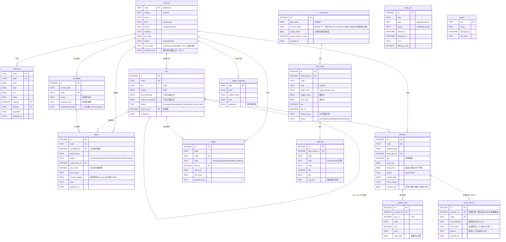

# 03 · 数据库ERD（SQLite）

> **单一事实源**：`internal/store/migrations/`（append-only，0001→0004，最新状态为事实源）。本文档是它的可视化与释义；两者必须同步修改（流程见《06-consistency》）。
> 版本：schema v4（2026-10-18）

---

## 1. ER图

> **复利前提（2026-10-27）**：回测按年独立起跑，`equity_snapshot` 每年首日 `total = 1,000,000`（起始资金），
> 年末含未平仓头寸的市价估值（即含浮盈浮亏）；`drawdown` 为**年内**距峰值回撤，逐年重置。
> 滚雪球复利按 `total_d / total_{d-1}` 逐日链式推演、跨年直接衔接，口径见 docs/01 §10.6。
> ⚠️ `e17_metrics.csv` 的 `ret` 列是**权益口径**（年末权益/100 万 − 1），`pnl` 列是**已实现口径**；
> 两者在 V 型年（如 2009）会背离，判读必须双口径并列，不得混用。

---

## 2. 领域状态机（数据完整性规则）

### 2.1 `box.status`

| 迁移 | 触发 | 守卫 |
|------|------|------|
| → forming | 出现新高候选 | - |
| forming → forming | 3日内又创新高 | 重置上轨候选 |
| forming → confirmed | 上轨3日确认+下轨3日确认 | top>bottom，宽度≥5% |
| confirmed → broken_up | 收盘>top×1.03且放量且非一字板 | 生成新箱体forming，prev指向本箱 |
| confirmed → broken_down | 收盘<bottom | 触发stop信号 |
| forming/confirmed → invalid | 下轨确立前创新高 / 横盘超参上限 | 保留记录不删除 |

### 2.2 `watch.stage`

| 迁移 | 触发 |
|------|------|
| → watching | candidate当日入池（blacklisted 冷却期内拦截；`pool.maxwatch` 降级软参考仅日志告警不拒绝入池——资金预算为唯一约束） |
| watching → pending | 箱体confirmed且挂停损买单计划生成 |
| pending → watching | 买单过期未成交（RelaxPendingWatches，B2接线） |
| pending → holding | 买单成交（trade_fill回录） |
| holding → exited | 止损成交 / 突破失败 / 3周不获利 / 人工移除 |
| watching → exited | 箱体broken_down / 连续4箱不涨 / 人工移除 |
| watching/holding → suspended | 人工挂起（`pool suspend --resume <价>`，B2） |
| suspended → watching | 收盘价 ≥ resume_trigger 激活价（poolsync 巡检） |
| watching/pending/holding → blacklisted | 战绩分级（0017）：最近一笔持仓周期亏损 `realized_pnl<0` → blacklist 冷却 `pool.blacklist_months` 月。A M1（2026-10-23）后 winner 档退役，流转简化为盈利→normal、亏损→blacklist 两态（docs/00 §5.6.5、docs/00 §5.6.7 D1） |

注：suspended 不占跟踪名额（`pool.maxwatch` 只计 watching+pending+holding，但已降级软参考）；blacklisted 冷却 `pool.blacklist_months` 月后解禁回 normal（0017 战绩分级，非终态；0003 起 CHECK 六值）。

### 2.3 `position.stop_price`

**只升不降**（DB层CHECK触发器 + 应用层双重防护）：任何更新若新值<旧值 → 拒绝并记审计日志。

---

## 3. 完整DDL

见 `internal/store/migrations/`（0001 初始 + 0002 fill.side + 0003 跟踪池生命周期 + 0004 已交易股票历史库，append-only，最新状态为事实源）。0003 要点：watch 表重建（stage 扩六值 + resume_trigger 列）、position 增 realized_pnl 列、4 个新参数种子。0004 要点：trade_review 复盘表（每笔 closed position 一条，`UNIQUE(position_id)` 重录覆盖；code 冗余存储便于按股索引查询；教训人工录入不自动生成——三记录制度见 docs/00 §6）。

要点：
- 主键策略：`daily_bar`用`(code,date)`复合主键；`box`/`signal`等用自增`INTEGER PRIMARY KEY`
- 金额与价格一律`REAL`（浮点），**展示层**做四舍五入；账本恒等式校验容忍1分误差
- 所有快照表（candidate/plan/equity）**只插入不更新**（append-only审计特性）
- `signal.payload_json`/`candidate.reasons_json`用JSON1扩展存储判定明细
- 外键：`PRAGMA foreign_keys=ON`（store.Open强制）

---

## 4. 索引设计

| 表 | 索引 | 服务于 |
|----|------|--------|
| daily_bar | `(code, date)`主键即索引 | 个股K线窗口读取（boxscan主路径） |
| daily_bar | `(date)` | 全市场当日截面（screen/pool） |
| box | `(code, status)` | 跟踪池当前箱体查找 |
| box | `(code, id)` | 阶梯链回溯 |
| candidate | `(screen_date)` | 初选日快照查询 |
| watch | `(stage)` | 池列表视图 |
| watch | `(code)` | 按股查池状态/两亏拉黑巡检（B2） |
| trade_review | `(code)` + `UNIQUE(position_id)` | 战绩按股查询 / 每笔一条复盘（B3） |
| plan_order | `(trade_plan_id, status)` | 计划视图 |
| position | `(status)` | 持仓/清仓过滤 |
| trade_fill | `(code, date)` | 成交幂等检查 |
| trade_fill | `(date)` | 成交按日查询（0002） |
| signal | `(date, type)` | 当日信号汇总 |
| signal | `(code, date)` | 个股信号历史（昨日状态对比，首次事件语义） |
| daily_run | `(date, task)` | 心跳视图/补跑判断 |

---

## 5. 数据量估算（10年运行）

| 表 | 行数估算 | 说明 |
|----|---------|------|
| daily_bar | 1.2万股票×2400交易日≈2900万行 | ~2GB，SQLite可承受；boxscan走(code,date)索引 |
| box | 数百万 | 多数invalid，可按年归档 |
| candidate/plan/signal | 每日百行级 | 忽略不计 |

> 扩展预案：daily_bar超5GB时按年分表（`daily_bar_2026`），store层路由，接口不变。

---

## 6. 研究字段：plan_order.reason_json（2026-10-25 立项）

> box 十维迭代实验（理论框架见 docs/00 §3.6）的核心数据载体是 `plan_order.reason_json`（JSON 文本字段）。回测器在生成每笔买入订单时，把信号触发时的 box 几何与 52 周新高上下文写入该字段；离线分析脚本（`e17_watch.py` / `e17_annual_tier_report.py` / `e17_*_report.py`）只读查询该字段做梯度分布统计。**允许**用 `daily_bar` 重算指数侧特征（MA / 回撤 / regime 标签），但**不得重算 box 几何与信号**——那是回测器的职责，重算会造成口径漂移。

### 6.1 已落地字段清单（当前 darvas_e17.exe 产出）

| 字段 | 类型 | 含义 | 对应实验维度 |
|------|------|------|-------------|
| `box_bottom` | number | 被突破箱体下轨价 | 第 2 维（box 高度）后验原料 |
| `box_top` | number | 被突破箱体上轨价 | 第 2 维 + 第 6 维后验原料 |
| `trigger` | number | 触发价 = `box_top × buy.premium` | 第 6 维（突破强度）—— ⚠️ 当前全部=box_top×1.03，无梯度 |
| `high_52w` | number | 截至突破日的 52 周最高价 | 第 5 维 + 第 4 维后验原料 |
| `newhigh_distance_pct` | number | `(high_52w - close) / high_52w × 100` | 第 5 维（box 位置）—— E17 阶梯分档依据 |
| `sizing_basis` | string | `newhigh_t1`/`t2`/`t3`/`t4` 之一 | 第 5 维档位标记 |
| `units` | number | 该笔订单的仓位单位数（1 单位=2% 权益） | 每单位净利计算分母 |
| `regime` | string | A 判据标签 `bull`/`bear`/`range`，**按 `plan_date` 当日计算**（`regime.ClassifyDateA`） | 第 10 维（头寸 regime）归因原料 |
| `signal` | string | 信号类型（`breakout` 等） | 审计（非研究字段） |
| `budget_bucket` | string | 预算桶（当前恒 `normal`） | 审计（非研究字段） |
| `track_level` | string | 跟踪级别（`normal`/`winner`/`blacklist`） | 审计（E17 后不再驱动 units） |

> 另有执行冗余键 `leg` / `stop` / `unit_shares` / `unit_value`，由 planner 写入用于下单与审计，**不入研究字段清单**。
> 本节 2026-10-26 补齐 `regime` 缺项——此前 §6.1 只列 7 个字段，而实际库中每笔订单产出 15 个键，属契约漂移。

### 6.2 待加字段（解锁其余维度，需改回测器 + 重编译）

| 待加字段 | 含义 | 解锁维度 | 改动位置 |
|---------|------|---------|---------|
| `volume_ratio` | 突破日量 / 过去 N 日均量 | 第 7 维（量比梯度） | `internal/signal` 信号生成处加计算 + 写入 reason_json |
| `box_height_pct` | `(box_top-box_bottom)/box_bottom × 100`（冗余存方便统计） | 第 2 维（已可后验，冗余字段只是省计算） | 可选 |
| `is_top_box` | bool：当前 box 是否为此前 N 个 box 序列的最高 | 第 4 维（最高 box，需 box 序列历史） | `internal/box` 加序列状态 + 信号生成处查询 |
| `break_strength_pct` | `(trigger - box_top) / box_top × 100`（参数化后才有梯度） | 第 6 维（需配合 `buy.premium` 参数化多轮跑） | `internal/contract` 加参数 + 信号生成处读参数 |

### 6.3 字段写入契约

- **写入时机**：`planner` 生成买入订单时，从 `signal` 上下文取上述字段，序列化为 JSON 写入 `plan_order.reason_json`。
- **只读查询**：离线分析脚本用 `json_extract(reason_json, '$.field')` 或 Python `json.loads` 读取，**不得反向修改**回测库。
- **字段缺失处理**：早期年份（2005-2013）的回测库若用旧版 darvas_e17.exe 跑，可能缺字段；分析脚本必须对缺失字段返回 None 并在报告里诚实标注"该年份无此字段"，不编造。
- **字段稳定性**：已落地字段（§6.1）的键名与语义冻结，不得改名或改义——跨年可比依赖于此；新增字段（§6.2）只能追加，不破坏旧库的可读性。
- **时点冻结（`regime` 专属）**：`regime` 记录的是 **`plan_date`（T 日）** 的 A 判据标签，**不是** `execute_date`（T+1）的。不得改义，也不得把 T 日标签当作 T+1 开盘的市场状态使用。实测差异：2014 年 plan 日与 opened 日标签一致率 86/100；14 年全样本升势笔数 107（plan 日）vs 91（建仓日）。归因报告若按 `opened_date` 重算，必须显式声明口径并与本字段对账。

### 6.4 position_leg 与 reason_json 的关联

- 每个持仓的第一腿（`position_leg.leg_no=1`）关联的 `plan_order.reason_json` 是该持仓的"出生证明"——含建仓时的全部 box 上下文。
- 离线分析以 `position_leg.leg_no=1 JOIN plan_order ON plan_order.id = position_leg.plan_order_id` 为基础视图，按 `sizing_basis` 分档统计四项口径（见 docs/01 §10.2）。
- 加码腿（leg_no>1）的 reason_json 不参与分档统计（避免同一持仓被重复计数）。

