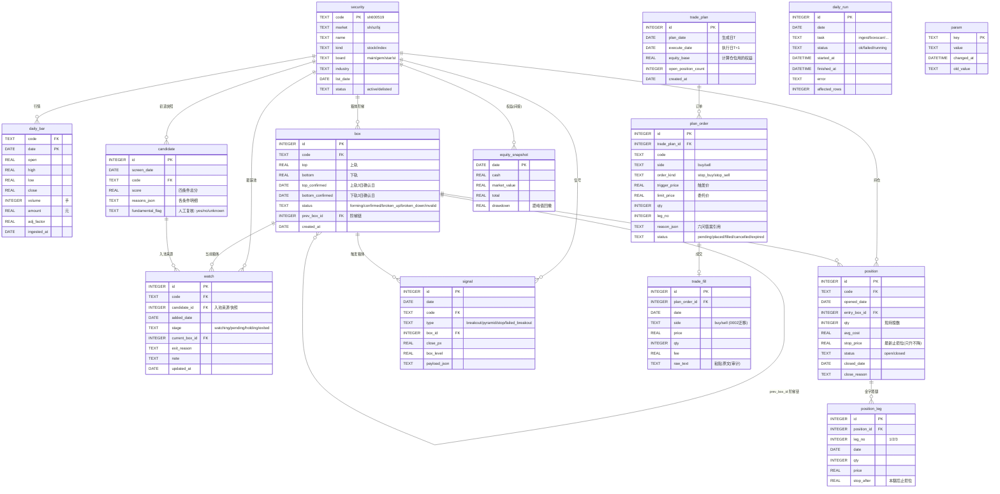

# 03 · 数据库ERD（SQLite）

> **单一事实源**：`internal/store/migrations/0001_init.sql`。本文档是它的可视化与释义；两者必须同步修改（流程见《06-consistency》）。
> 版本：schema v1（2026-10-17）

---

## 1. ER图

---

## 2. 领域状态机（数据完整性规则）

### 2.1 `box.status`

| 迁移 | 触发 | 守卫 |
|------|------|------|
| → forming | 出现新高候选 | - |
| forming → forming | 3日内又创新高 | 重置上轨候选 |
| forming → confirmed | 上轨3日确认+下轨3日确认 | top>bottom，宽度≥5% |
| confirmed → broken_up | 收盘>top×1.03且放量且非一字板 | 生成新箱体forming，prev指向本箱 |
| confirmed → broken_down | 收盘<bottom | 触发stop信号 |
| forming/confirmed → invalid | 下轨确立前创新高 / 横盘超参上限 | 保留记录不删除 |

### 2.2 `watch.stage`

| 迁移 | 触发 |
|------|------|
| → watching | candidate当日入池 |
| watching → pending | 箱体confirmed且挂停损买单计划生成 |
| pending → holding | 买单成交（trade_fill回录） |
| holding → exited | 止损成交 / 突破失败 / 人工移除 |
| watching → exited | 箱体broken_down / 连续4箱不涨 / 人工移除 |

### 2.3 `position.stop_price`

**只升不降**（DB层CHECK触发器 + 应用层双重防护）：任何更新若新值<旧值 → 拒绝并记审计日志。

---

## 3. 完整DDL

见 `internal/store/migrations/0001_init.sql`（本仓库已含，为唯一事实源）。

要点：
- 主键策略：`daily_bar`用`(code,date)`复合主键；`box`/`signal`等用自增`INTEGER PRIMARY KEY`
- 金额与价格一律`REAL`（浮点），**展示层**做四舍五入；账本恒等式校验容忍1分误差
- 所有快照表（candidate/plan/equity）**只插入不更新**（append-only审计特性）
- `signal.payload_json`/`candidate.reasons_json`用JSON1扩展存储判定明细
- 外键：`PRAGMA foreign_keys=ON`（store.Open强制）

---

## 4. 索引设计

| 表 | 索引 | 服务于 |
|----|------|--------|
| daily_bar | `(code, date)`主键即索引 | 个股K线窗口读取（boxscan主路径） |
| daily_bar | `(date)` | 全市场当日截面（screen/pool） |
| box | `(code, status)` | 跟踪池当前箱体查找 |
| box | `(code, id)` | 阶梯链回溯 |
| watch | `(stage)` | 池列表视图 |
| plan_order | `(trade_plan_id, status)` | 计划视图 |
| signal | `(date, type)` | 当日信号汇总 |
| daily_run | `(date, task)` | 心跳视图/补跑判断 |

---

## 5. 数据量估算（10年运行）

| 表 | 行数估算 | 说明 |
|----|---------|------|
| daily_bar | 1.2万股票×2400交易日≈2900万行 | ~2GB，SQLite可承受；boxscan走(code,date)索引 |
| box | 数百万 | 多数invalid，可按年归档 |
| candidate/plan/signal | 每日百行级 | 忽略不计 |

> 扩展预案：daily_bar超5GB时按年分表（`daily_bar_2026`），store层路由，接口不变。
