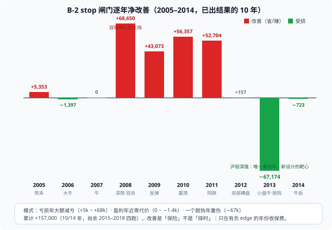
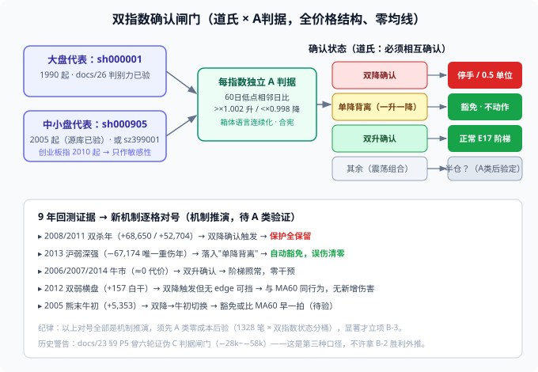

# 31. 双指数确认闸门设计草案（维度 10 · 第三轮立项讨论稿）

> **日期**：2026-10-27 06:40　**状态**：草案（Draft）——记录用户与 AI 就 MA60 闸门改进方向的完整讨论与初步意向，**待用户拍板后立项**
>
> **谱系关联**：docs/00 §5.6.8（A 判据谱系，用户 10-22 拍板「箱体语言连续化」）· docs/29 §五 B-1/B-2（MA60 闸门对照实验）· docs/experiments/e17_regime_gate_report.md（B-2 全 14 年补跑中）· docs/00 §5.6.7 已否决清单（闸门历史证伪记录）· docs/00 §3.6（十维宪法）
>
> **红线声明**：本文只讨论 **regime 分桶工具**（仓位闸门），不触碰入场信号（docs/00 §9）。MALF 机制不引入——只借鉴其「结构优先于指标」的哲学。

---

## 一、问题定义：MA60 闸门的「大功小过」

B-2（上证 MA60 下方停手）全 14 年已收官（2026-10-27，14/14）：三判据全过、改善 +132,136、亏损年减亏 66.2%；14 年呈现高度一致的模式：

| 年份 | 市况 | 基线净利 | stop 净利 | 改善 | 闸门做对了/错了什么 |
|---|---|---:|---:|---:|---|
| 2005 | 熊末牛初 | −14,693 | −9,340 | +5,353 | 减亏，但幅度最小 |
| 2006 | 大牛 | +223,911 | +222,514 | −1,397 | 6 笔拦截，零代价 |
| 2007 | 牛 | +421,255 | +421,255 | 0 | 已实现逐分相同 |
| 2008 | 深熊双杀 | −79,655 | −11,005 | **+68,650** | 保护主场，减亏 86% |
| 2009 | V 型反弹 | −9,639 | +33,434 | **+43,073** | 磨底段输家被拦 |
| 2010 | 震荡 | −53,345 | −14,884 | +38,461 | 减亏（half 反超年，勘误见 gate_report §七.4） |
| 2011 | 阴跌 | −85,243 | −32,539 | **+52,704** | 减亏 62% |
| 2012 | 双弱横盘 | −26,584 | −26,427 | +157 | 231 次拦截，白干 |
| **2013** | **沪弱深强** | **+81,564** | **+14,390** | **−67,174** | **指数与交易池脱钩，系统性误伤** |
| 2014 | 牛市启动 | +182,188 | +181,465 | −723 | 零代价且 PF/夏普双改善 |



**病灶诊断**：MA60 的问题不是「尺子不准」（2008/2010/2011 它跑得极好），是**镜子错了**——`sh000001` 是金融+两桶油+白酒的加权，2013 年创业板涨 80% 它毫无感知，闸门把 311 笔小盘箱体突破挡在门外。**闸门需要的不一定是更好的尺子，而是更对的镜子。**

三个待决缺口，正好对应三条候选改进方向：

1. **代表性缺口**（2013）：单一指数永远有下一个脱钩年；
2. **无效年缺口**（2012）：触发 231 次但无 edge 可挡，白干且 PF 恶化（0.65→0.29）；
3. **强度缺口**：stop 是二值开关，没有中间档。

---

## 二、用户立场与资料来源（讨论前提）

### 2.1 用户立场（2026-10-27 05:03 原话归纳）

1. **对所有均线及一切量价衍生技术指标不感冒**——天然缺陷，MA60 属于「大功小过」；
2. **倾向原始道氏理论定义**：至少选代表大盘股和小盘股的两个指数相互验证；若选三个，采用投票机制；
3. **各指数自身的历史，是预判未来的最好老师**。

### 2.2 资料阅读登记（2026-10-27 05:05）

| 资料 | 关键提取 |
|---|---|
| 《专业投机原理》OCR（维克多·斯波朗迪，第 4 章道氏理论） | 雷亚假设/定理；**确认日定义**（两种指数都突破才确认）；斯波朗迪的更新原则：**「所有相关指数都必须相互确认」**（1987 崩盘教训）；1-2-3 准则与 2B 准则（趋势变动的价格结构定义，零指标）；雷亚/斯波朗迪的 1896–1985 趋势归类表（「指数历史是老师」的方法论） |
| malf-Definitive v2.1（H:\《交易之no.14.year》\…） | wave/Range 价格结构框架；「结构位置优先于指标」哲学与道氏同源 |
| malf-engine（H:\malf-archived） | 结构计算引擎（112 tests）；**仅作哲学参照，机制禁入**（docs/00 §9 红线） |
| docs/00 §5.6.8（项目内） | A 判据诞生记录：用户否决 200 日均线（「太慢，实战拉」）；「60 日低点抬升」是箱体下轨抬升的连续化，判别力实测强 |
| docs/00 §5.6.7 已否决清单（项目内） | **历史警告**：熊市闸门曾六轮证伪（C 判据口径，−28k~−58k） |

### 2.3 哲学主线（一个值得记录的观察）

**道氏理论（1896，高低点结构）→ Darvas 箱体（1960，箱体结构）→ 用户 MALF（wave/Range 结构）→ 系统 A 判据（60 日低点结构）**——四者相隔百年，本质是同一件事：**价格结构优先，指标其次**。MA60 闸门是这个体系里唯一的「指标外来者」，它的大功小过是**类别问题而非参数问题**。

---

## 三、三条候选方向的分析

### 3.1 方向一：更换指数 → 升级为「双指数相互确认」（用户道氏直觉的落点）

**① 数据可行性（2026-10-27 05:00 于 full_hist_10pct.db 实测）**

| 指数 | 数据覆盖 | 判定 |
|---|---|---|
| sz399001 深证成指 | 1991-04 起（8,698 根） | ✓ 全 14 年可用 |
| sh000905 中证500 | 2005-01-04 起（5,289 根） | ✓ 全 14 年可用 |
| sh000852 中证1000 | 2005-01-04 起（5,289 根） | ✓ 全 14 年可用 |
| sh000300 沪深300 / sh000016 上证50 | 2005 起 | ✓ 全 14 年可用 |
| sz399005 中小板指 | 2006-01 起 | △ 缺 2005 |
| **sz399006 创业板指** | **2010-06 起** | **✗ 不能进主判据** |

**② 单一换指数：否决。** 创业板指会把 2005–2009 变成结构性空档；单一换成中证500 只是把锚从一个指数换到另一个——2017 漂亮50 行情里中证500 跑输上证50，那一年它就是下一个 2013。**单一指数永远有下一个脱钩年。**

**③ 双指数相互验证：机制成立。** 斯波朗迪把雷亚「两种市场指数必须相互确认」更新为「所有相关指数都必须相互确认」；映射到闸门语义：

- **双降确认**（两指数同降势）→ 停手（2008/2011 的保护原样保留）
- **单降背离**（一升一降）→ **豁免**（2013 的 −67,174 **机制性清零**——那年沪弱、深市/中小盘强，正落背离格）
- **双升确认** → 正常 E17 阶梯（2006/2007/2014 的零干预原样保留）

**④ 三指数投票：降级为敏感性对照。** 创业板指 2010 年起才有 → 三票制在 2005–2009 只有二票，「全历史同尺」被切成两段。主判据固定双指数；创业板指只在 2010 后做附加敏感性报告，不参与判定。

**⑤ 状态判定不用均线，用 A 判据**（60 日低点相邻日比：`>×1.002` 升 / `<×0.998` 降 / 其余震荡，lookback=60）。这是 docs/00 §5.6.8 里用户拍板的「箱体下轨抬升连续化」，判别力实测过（60 日档最稳），已在生产运行。整个闸门**零均线、全价格结构**——与用户立场、MALF 哲学、道氏定义三者同源，且比 MA60 更合宪（regime 分桶用结构判据的先例就是 A 判据本身）。

### 3.2 方向二：个股自身均线 → 建议否决（原始诉求另有归宿）

1. **哲学**：为去指数化反而引入更多均线，方向反了；
2. **结构冗余**：维度 5 的 E17 阶梯**已经是个股级 regime**——`newhigh_distance_pct` 就是「个股距自身 52 周高点的结构位置」，t4 档 0.5 单位就是「个股深回撤降仓」。再叠一层是同一信息买两次保险。P0-3 已实测这种冗余：2008 年 MA60 下方 28% 的订单本来就是 t4，**没有再降的空间**；
3. **正确归宿**：docs/00 §5.6.8 用户原始诉求「指数和个股同向验证，同时升势才买」的价格结构翻译 = **维度 3（box 是否处于升势，P3-8 待立项）**，用个股 60 日低点抬升做准入过滤。它已在十维账本排队，不新开方向。

（例外条款：若 A 类后验发现个股结构状态与阶梯档位正交——Jaccard 低且各自独立贡献 edge——可重新立项；先验判断冗余度高，优先级最后。）

### 3.3 方向三：half → 单独不成立，与方向一合流为「分级闸门」

数据不支持单独回退 half：2008 深熊里 stop 比 half 多止血 19,871；half 在牛市省的保费（2007：−14,078 vs −24,351 未实现）不构成翻盘理由。

但合流后有意义：**分级闸门 = 确认等级分级**，这正是道氏原意——未确认的信号只配更轻的动作。双降确认→停手；单降背离→豁免；**震荡组合偏弱→half（这一档是否需要，A 类后验说了算，不拍脑袋加）**。half 从「永远付半价的保险」变成「只在模糊状态付的小额保费」，它 2010 年的出色表现（减亏 86%）有机会在正确场景复用。

---

## 四、推荐设计总览



**一句话**：`sh000001`（大盘镜）+ `sh000905`（中小盘镜，或 sz399001）→ 各自跑 A 判据（价格结构，零均线）→ 道氏确认矩阵四态 → 分级动作。

| 确认状态 | 判定 | 动作（草案） |
|---|---|---|
| 双降确认 | 两指数 A 判据同降势 | 停手 或 0.5 单位（**开放问题 2**） |
| 单降背离 | 一升一降 | 豁免 · 不动作 |
| 双升确认 | 两指数同升势 | 正常 E17 阶梯 |
| 其余 | 震荡组合 | 不动作 或 half（**开放问题 3**） |

---

## 五、与 10 年证据的对号（机制推演，非结论）

| 证据 | 新机制的预期行为 | 验证方式 |
|---|---|---|
| 2008/2011 双杀（+68,650 / +52,704） | 双降确认触发 → 保护全保留 | A 类桶 1 每单位净利须深负 |
| 2013 脱钩（−67,174） | 落入单降背离 → 误伤清零 | A 类桶 2 应不亏 |
| 2006/2007/2014 牛市（≈0 代价） | 双升确认 → 零干预 | A 类桶 3 应为正 |
| 2012 双弱横盘（+157 白干） | 双降触发但无 edge 可挡 → 与 MA60 同行为，无新增伤害 | 接受（闸门不解决无 edge 年） |
| 2005 熊末牛初（+5,353） | 结构切换比 MA60 早一拍（假设） | A 类：A 判据与 MA60 的时点差分析 |

---

## 六、三枚地雷（历史警告，任何一轮都必须重读）

1. **docs/00 §5.6.7 已否决清单 六轮证伪过「熊市闸门」**（C 判据口径，−28k~−58k）。双指数 A 判据闸门是**第三种口径**，P0-3 硬教训：三口径 Jaccard 仅 0.08——**B-2 的胜利不能外推给它，必须重走 A→B 全链路**；
2. **docs/00 §5.6.8 用户已否决过两类东西**：200 日均线（「太慢，实战拉」）和默认参数箱体扫指数（粒度过粗，五年仅 8 个箱体，无判别力）。新设计的可行性依赖 **A 判据的连续化版本**，不是这两者的复活；
3. **2012 教训**：闸门活动 ≠ 价值。触发 231 次、钱包不动、PF 反而恶化——新设计必须通过「双降桶每单位净利显著深负」这一检验，否则就是又一个 2012。

---

## 七、下一步路线（A 先 B 后，判读口径跑前写死）

```
第 1 步 ✅（2026-10-27 收官）：B-2 全 14 年三判据全过 → 总判读见 e17_regime_gate_report §七
第 2 步（半天，零成本）：A 类后验 e17_dual_index_bucket——14 年 1328 笔
        × 双指数 A 判据状态分桶（双降/背离/双升/震荡），四项口径 + n/m 并列
第 3 步（A 类显著才立项）：B-3 双指数分级闸门，代表年 2008/2010/2011/2013——
        必须含 2013 反例年，改进设计必须在反例年不出错才算数
```

**A 类后验的判读口径（本草案预登记，跑前写死）**：

1. 双降桶每单位净利显著为负，且深于 MA60 下方桶（P0-3 实测 −249）→ 方向成立；
2. 2013 的交易大量落入背离桶且该桶不为负 → 误伤清零的证据；
3. 双升桶为正且不劣于全样本平均 → 豁免机制无害；
4. 任一桶 n≥30 且 m≥20 才给裁定标签（P0-3 有效样本纪律）。

---

## 八、开放问题（待用户拍板）

1. **中小盘代表选谁**：`sh000905` 中证500（与 E17 候选池同构性更好）vs `sz399001` 深证成指（1991 起、历史最长、道氏「两部门对照」的原教旨形态）？——可在 A 类后验里两个都跑，用数据定；
2. **双降确认的动作**：停手（B-2 同强度）还是 0.5 单位（B-1 同强度）？
3. **震荡组合是否给 half 档**：还是保持二档简化（确认/豁免）？
4. **宪法注释文案**（docs/00 §3.6 维度 10 下拟加一行）：「regime 工具允许：指数 MA / 指数价格结构（A 判据谱系）/ 多指数相互确认；一律禁止作入场信号」——需要你确认措辞。

---

## 附：产物规划（立项后）

| 产物 | 说明 |
|---|---|
| `scripts/e17_dual_index_bucket.py` | A 类后验脚本，只读 14 年 e17 基线库，零回测 |
| `docs/experiments/e17_dual_index_bucket_report.{md,html}` + `_data.json` | 分桶报告（框架先行：零结果纯规则 → 执行 → 汇报） |
| B-3（若立项） | `gate.dual_index.mode` 参数化，沿用 b12 队列与 off 等价验证纪律 |
