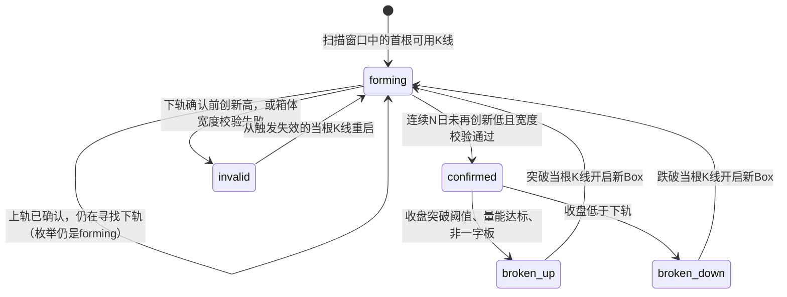
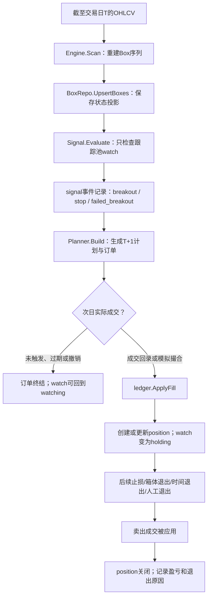
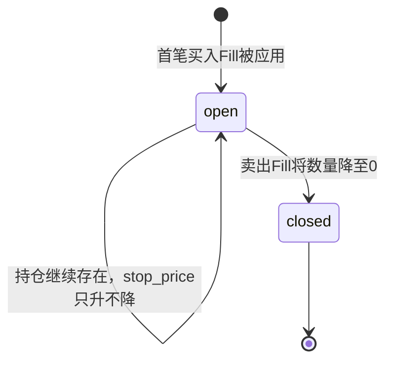

# 34 · Darvas Box 生命周期与交易接触点审计（GPT，2026-10-29）

> 作者：GPT（网页版远程审计）｜ 审计对象：GitHub main 分支 2026-10-29 代码与 docs/00–06、29
> 归档日期：2026-10-29 ｜ 性质：工程事实审计与目标契约提案——不改策略参数、不改 schema、不改交易行为
> 原始载体：`34-box-lifecycle-audit-gpt-20261029.zip`（含本文件原稿 + CHANGESET.md + apply_lifecycle_audit.py，同存本目录）

> ## 归档声明（2026-10-29 审计折叠收尾时写）
>
> - 本审计的技术断言已于 2026-10-29 被逐条对照本地代码/ schema **复核属实**：`box` 表无
>   start_date/invalidated_date/invalid_reason；trigger=top×1.03 与初始 stop=top×0.97 →
>   计划止损距离 1−0.97/1.03≈5.83%；`UpsertBoxes` 按上下轨价格对复用 ID；每日批处理按
>   最近 800 根窗口重算；`Engine.Scan` 为零 IO 确定性纯函数；invalid 由 forming 触发且同根
>   K 线重启（`invalidateAndRestart`）、不计入阶梯。
> - **结论沉淀去向（SSoT 折叠，主目录不保留 34）**：
>   - docs/00 §3.7（范围限定 + 第 1.1「生命体五个可验收工程属性」+ 第 6 点侧面乙 + §5.1 价格口径澄清）——commit b10fbbb
>   - docs/29 §七 A0/A1 前置工程测试 + §五/§五之二 队列第 0 项——commit b10fbbb / 5ae0783
>   - docs/05 M10.6 优先级 0——commit 5ae0783
>   - docs/01 §5.2 FR-206~208（待实现）、docs/03 §2.1 迁移表校正与证据缺口注记、
>     docs/04 §4.1 持久化边界、docs/06 §3.1 生命周期不变量——2026-10-29 审计折叠收尾
> - CHANGESET 中「在主目录新建 docs/34」的提案**未采纳**（违反 docs/README 引用规则第 4 条
>   「新工作不新建文档，先回 00-06/29 沉淀」）；apply_lifecycle_audit.py 的自动补丁路径亦未使用
>   （由人工折叠替代，吸收范围与 CHANGESET 有差异：01/02/03/04/06 的修订延后至收尾时完成）。
> - 本档保留价值：L1–L8 缺口总账、Box 状态图、Box→Signal→PlanOrder→Fill→Position 事件流图、
>   数学工具边界（离散转移系统 vs 微分方程/线性变换）与 A0–A3 实验顺序。
>   原稿全文如下，一字未改。
# 34 · Darvas Box 生命周期与交易接触点审计

> 审计日期：2026-10-29  
> 审计对象：`everything-is-simple/Darvas-box-trading` main 分支当前 Go 实现及 docs/00–06、docs/29  
> 性质：工程事实审计与目标契约提案；本文件不改变策略参数、数据库 schema 或交易行为。  
> **核心结论：Box 引擎已经有确定性的离散状态转移，但完整生命周期目前只在一次有限窗口扫描中成立；持久层保存的是重算后的状态投影，而不是完整的生命周期事件账。**

## 1. “活着”必须变成可验收的工程定义

“生命体”是一个有启发性的设计隐喻，但不能把隐喻当作已实现的事实。这里将它拆为五个可测试属性：

| 属性 | 工程定义 | 当前审计结论 |
|---|---|---|
| 有状态 | 时点 t 有足够决定下一步行为的状态向量 | **单次 Scan 内成立**；仅有 status 枚举不够，候选价、计数器、确认日也是状态 |
| 有活动 | 新的、按时间排序的 K 线进入后按规则推进状态 | Scan 内每根 K 线调用 step；每日批处理不是所有股票都无条件重放 |
| 有始 | 可回答逻辑出生时间、出生输入与前驱 | 当前输出没有 start_date；800 根窗口首根 K 线不等于真实出生时间 |
| 有终 | 可回答何时、因何进入不可逆终态 | broken_up / broken_down 有 broken_date；invalid 没有独立失效日期/原因字段；扫描末尾仍可处于活动状态 |
| 可追溯、可复演 | 相同历史输入和参数能重建相同轨迹，并核对每次迁移 | 引擎确定性是良好基础；持久层缺少迁移事件账，实例身份也未被定义为不可变身份 |

因此，严格答案是：**Box 的算法心脏已经活了；可观测、跨重算稳定、带完整出生/死亡证据的领域实体还没有完全落地。** “每根 K 线推进状态”指的是引擎内部计算，不代表数据库已永久记录每次迁移。

## 2. 当前代码里，Box 实际如何运动

### 2.1 状态不止五个单词

Go 合约中的 BoxStatus 是五值枚举：`forming`、`confirmed`、`broken_up`、`broken_down`、`invalid`。

但 forming 内至少有两个内部子阶段：

1. 上轨候选阶段：`top_confirmed` 为空；
2. 上轨已确认、下轨候选/确认阶段：`top_confirmed` 非空，但 `bottom_confirmed` 尚为空，直到下轨确认。

这两个阶段在数据库枚举中都叫 forming；图上的 `forming_bottom` 是概念阶段，不是当前 BoxStatus 的真实枚举。内部 scanner 还保存 `topCandidate`、`topCount`、`top`、`bottomCandidate`、`bottomCount`、确认日期与前驱引用。**只看 status 一个字段，状态描述是不完备的。**

### 2.2 当前状态图（贴近 `internal/box/engine.go`）



形成阶段使用 high/low 与连续未创新高/低日数；突破阶段还检查价格阈值、此前成交量均值与一字板条件。宽度门槛是工程参数，不能误称为原著本身的必然规则。

### 2.3 当前生命周期边界

`Engine.Scan` 是确定性、零 IO 的纯函数：输入一段按时间排序的 OHLCV，输出这段数据推导出的 Box 序列。scanner 的运行状态不跨 Scan 调用保存。

每日批处理 `scanner.go` 通常读取最近 **800 根交易日 K 线**后重新计算，再由 `BoxRepo.UpsertBoxes` 写回。它不是从数据库恢复上一次 Box 的全部内部计数器后继续一步步更新，而是按输入窗口重新推导。

`UpsertBoxes` 通过上轨/下轨数值对（格式化到六位小数）寻找可复用的数据库 ID，再更新状态和前驱引用；没有匹配到且未被业务外键引用的旧记录可能被删除。因此：

1. 窗口内第一个 Box 的逻辑出生时间可能早于窗口，但当前行不能证明；
2. 数据库 ID 不是受契约保证的永久 Box 实例身份；相同上下轨价格对可能参与 ID 复用；
3. `prev_box_id` 是当前重算序列的阶梯关系，不是独立追加、永不改写的生命谱系日志。

`created_at` 是数据库行插入时间，不是市场中的 Box 出生时间。`broken_date` 可说明突破/跌破日期，但 invalid 的失效时间与原因没有独立结构化字段。扫描结束时仍存活的 forming/confirmed Box 是“截至输入末尾的状态”，不是已经死亡的对象。

## 3. Box 与买入、持仓、平仓：三个不同层级

### 3.1 事件流水图



**Box 状态、Signal 事件、PlanOrder 计划、Fill 成交、Position 持仓，是五种不同对象。** 不应把“突破已发生”“系统已发信号”“已生成买单”和“已经开仓”说成同一件事。

### 3.2 开仓：Box 能触发候选事件，但不能单独创造持仓

当前开仓链的主要规则与门槛：

1. Box 引擎将 confirmed Box 标成 `broken_up`：收盘价高于 `top × buy.premium`（默认 1.03），当日成交量达到此前 50 根 K 线均量 × 2，且不是一字板。
2. signal 引擎只检查 watch 处于 watching / pending / holding 的股票，并要求 `broken_up` 的 `broken_date` 是当日；持仓股不会产生加码信号。
3. planner 继续执行观察期、已持仓拦截、仓位预算、现价与触发价偏离等规则，才可能生成 T+1 的停损买入计划。
4. 只有成交被 ledger 应用后，系统才创建 position，并把 watch 状态迁移为 holding。

因此，Box 的 breakout 是**入场链的触发事件**，不是开仓事实。若订单未成交、跳空越过允许价格或被取消，Box 可以已经 broken_up，但账户没有持有该股票。

### 3.3 持仓：由成交账本维持，不是 Box 的一个状态

position 是另一台状态机：



watch 自身还有 watching、pending、holding、exited、suspended、blacklisted 等状态；watch 与 position 是不同实体，不能用 `watch.stage` 代替 `position.status`。

持仓期的 Box 接触点主要是移动止损候选：`planner.raiseStops` 读取最新已落定 Box；下轨必须存在且已确认，且不能是入场 Box；候选止损为 `bottom × sell.discount`（默认 0.97），只有高于现有 stop_price 才更新。数据库触发器也禁止 stop_price 下降。

### 3.4 平仓：不止一种出口，也不全由 Box 终态触发

| 出口 | 触发语义 | Box 是否直接参与 |
|---|---|---|
| 最新 Box 下轨首次被收盘跌破 | signal stop；planner 按 Box 下轨 × sell.discount 生成次日卖单 | 是 |
| 短期突破失败 | broken_up 后短窗口内首次收盘跌回该 Box 上轨之下，生成 failed_breakout | 是 |
| `position.stop_price` 保护单 | 持仓 stop_price 被触发；初值取被突破 Box 上轨 × sell.discount，之后可能随更高的确认下轨上移 | 间接参与 |
| `time_stop_noprofit` | 持有达到参数门槛而仍未获利时退出 | 否；是持仓/资金效率规则 |
| 复权跳空清仓、人工卖出等 | 撮合或人工成交路径 | 否；是执行/账本边界 |

Box `broken_down` 不等于 position 已经 closed：正常链路还要形成计划或保护单，且卖出 Fill 被应用。反过来，time stop 或复权处理也能关闭 position，而 Box 未必进入 broken_down。因此 Box 状态图不能代替交易全系统状态图。

### 3.5 需要单独核实的价格语义

当前 `buyOrder` 的入场触发价是 `top × 1.03`，首次记录的 position stop 是 `top × 0.97`。若按计划触发价衡量：

`初始止损距离 = 1 − 0.97 / 1.03 ≈ 5.83%`。

这不是 3%。实际成交还可能因跳空、滑点、整手取整等改变实际风险。这里不直接改参数，因为那是交易规则变更；应先明确预期口径，再在回测里分别统计计划价风险、实际成交风险与实际止损结果。

## 4. 应该用什么数学工具

### 4.1 核心是离散时间转移系统，不是微分方程

合适的抽象是：

```text
X(t+1) = F(X(t), OHLCV(t+1), 参数)
```

X 不只是 status，还包括候选价、确认价、计数器、确认日、当前 Box 引用与谱系上下文。引擎按交易日离散地接收新 K 线并按规则计算下一个状态。

因此：

- **不需要微积分或微分方程**才能实现达瓦斯 Box。给状态机硬套连续 ODE 会丢失“连续 N 个交易日未创新高/低”这种离散守卫条件。
- 不能说五个 status 自身就形成完备的马尔可夫状态，更不能简单说它们之间的转移概率都是 0 或 1。只保留状态标签时，下一步仍取决于价位、计数器、参数和新 K 线；标签不是充分状态。
- “活动”可测为每日状态变化、等待天数、上/下轨确认延迟、Box 存续交易日、阶梯高度变化、从新 Box 确认到 stop_price 上移的滞后等离散量。它们可用于观测和归因，但不自动成为新的策略维度。
- 相邻 Box 上轨差、箱体高度、`top × 1.03`、`bottom × 0.97` 都是数值计算；乘常数可称为价格的标量缩放，但**不是 Box 状态之间的线性变换**。状态迁移是条件规则，而不是线性代数意义上的矩阵作用。

### 4.2 概率与统计需要在哪里

执行层应保持确定性：相同可用输入、参数和状态，应该得到相同信号。概率统计主要用于验证**确定性规则在历史样本中是否有稳定收益/风险表现**，而不是每次决定要不要突破。

研究层至少应该查看样本量、胜率、每笔/每单位净利、保本胜率、Profit Factor、利润集中度、剔除前三赢家后的结果、按年份/市场阶段的稳定性，以及 MFE/MAE、回吐率、止损上移滞后和不同退出原因的分布。单一大赢家、单一年份或单一最优参数都不足以证明 edge。必须遵守 docs/29 的样本量、跨年一致性、只改一个变量与复利/回撤双指标判据。

**规则如何执行是确定性问题；规则长期是否值得执行是统计问题。**

## 5. 当前缺口、风险和验收方向

| 编号 | 当前缺口 | 可能造成的误判 | 建议验收方向 |
|---|---|---|---|
| L1 | 没有 Box 逻辑 start_date | 无法证明真正出生时间/寿命 | 为重建输出和持久实例定义起始时间语义 |
| L2 | invalid 没有独立终止日期与结构化原因 | 作废事件难审计/统计 | 结构化记录 invalidated date/reason |
| L3 | 只有状态投影，没有 Box transition event log | 看得到重算结果，看不到每一步何时发生 | 先生成影子事件/离线对照，再决定是否需要 append-only 事件表 |
| L4 | 固定 800-bar 重算窗口 | 窗口首 Box 可能左截断；窗口变化时历史谱系可能变化 | 测试完整历史、800 窗口与增量路径的一致性，并标明观察边界 |
| L5 | Box 身份按价格对匹配复用 | 数值相同不必然是同一逻辑生命 | 明确逻辑实例键与数据库代理主键区别 |
| L6 | signal 到 plan_order 缺少显式 source signal ID 外键 | 难将某次突破精确追到成交 | 加强事件关联；在 schema 设计完成前不声称强引用已存在 |
| L7 | Box 下轨退出与 position.stop_price、time stop 并行 | 报表可能把退出混为一类 | 按明确 exit reason / 实际 Fill 分解统计 |
| L8 | top × 1.03 与 stop=top × 0.97 对计划触发价对应约 5.83% 距离 | “3%止损”口头描述与计划距离不一致 | 先写清定义，再做不改变基线的风险距离分布分析 |

目前不宜宣称 Box 的完整生命史在生产数据中已自我完备。这不否定引擎的价值，而是区分“状态机计算正确”与“生命周期事实可永久追踪”两种成熟度。

## 6. 实验顺序：先验证轨迹，再判断规则

本次为文档与代码静态审计，没有运行本地回测；以下是建议执行序列，不是已完成的实验结果。

### A0 · 确定性与状态迁移契约（工程测试，零策略变更）

1. 为 forming 内两个子阶段构造边界样本，验证高点/低点重置、连续 N 日确认、宽度失败、上轨突破、下轨跌破。
2. 验证 terminal Box 不会回到 confirmed；终止触发当根 K 线仅创建一个新 forming Box；prev_box_id 无环且时间顺序合法。
3. 相同 K 线、参数重复 Scan 的输出逐字段一致；同一数据库同日重算结果一致。
4. 对比同一历史的全量重算、每日增量重算和最近 800 根重算，逐日比较 Box、Signal、PlanOrder 的差异。差异必须解释为窗口/输入语义，而非默认忽略。

### A1 · Box 生命周期可观测性（A 类零策略变更）

对每个 Box 实例构造事件视图：首次观测、上轨确认、下轨确认、confirmed、broken_up、broken_down、invalid；区分“事件发生日期”与“系统首次观测日期”。对 800 日窗口左边界截断的实例标成 left-censored/出生未知；末端仍活跃的实例标成未终结/右删失，不伪造出生或死亡日期。

输出至少包括 Box 数量与终态占比、形成阶段等待日数、Box 存续日数、阶梯上移幅度、破裂类型分布、身份复用/删除计数、全量与窗口重建差异率。先用离线分析构造，不先改生产 schema。

### A2 · 止损随 Box 上移事件研究（docs/29 既有队列中的工程前置）

沿用 docs/29 已登记的 Box-driven stop-ratchet 研究；它属于既有第 8/9 维出场验证，不是新增第十一维。先验证事件日期与 Box identity 的可信度，再统计“更高 Box 下轨确认 → position.stop_price 上移”的滞后、从未上移比例、实际 MFE/MAE/回吐率与按终止原因的分布。报告须标明窗口重建边界，不能把猜测的完整寿命当事实。

### A3 · 只有前两阶段暴露结构性问题时才做 schema 设计

候选方向包括 Box immutable logical identity、started_date、invalidated_date / terminal_reason、数据/参数版本与 append-only transition event；另一个候选是 signal 到订单的 source-event 外键。

这些都需要先写 migration 方案，更新 docs/03 ERD、docs/04 contract、docs/06 不变量和测试，再实现；禁止直接改已发布 migration。**本次不新增数据库列/表，也不声称这些事件已被保存。**

## 7. 文档契约

- 理论与数学边界：docs/00 §3.7。
- 功能需求与验收标准：docs/01 §5.2。
- 运行数据流：docs/02 §10。
- 当前 schema 与不可追溯字段：docs/03 §2.1。
- Go 合约边界：docs/04 §10。
- 工程任务队列：docs/05 M10.7。
- 不变量与变更门槛：docs/06 §8。
- 策略实验唯一纲领仍是 docs/29；本审计不扩张十维，也不改交易参数。

